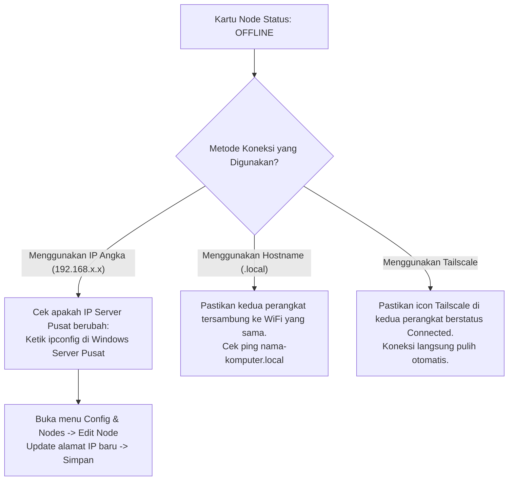

# 🌾 Panduan Operasional AgroSync Hub: Setup Node, Migrasi DDL, & Sinkronisasi

Panduan ini disusun secara langkah demi langkah (*step-by-step*) dengan bahasa yang mudah dipahami oleh pengguna umum (*non-technical friendly*). Dokumen ini mencakup panduan pembuatan database node baru (Mode 1 Database & Batch Multi-Database), eksekusi migrasi skema DDL, sinkronisasi data DML, pengurutan aktivitas transaksi, serta solusi penanganan perubahan IP (Hostname & Tailscale).

---

## 📑 Daftar Isi
1. [Struktur Navigasi URL & Menu Aplikasi](#struktur-navigasi-url--menu-aplikasi)
2. [Langkah 1: Menambah Database Node Baru](#langkah-1-menambah-database-node-baru)
   - [A. Mode 1 Database (Input Tunggal)](#a-mode-1-database-input-tunggal)
   - [B. Mode Banyak Database / Batch (Tarik Otomatis dari Server Pusat)](#b-mode-banyak-database--batch-tarik-otomatis-dari-server-pusat)
   - [C. Proteksi Duplikasi Target & Resolusi IP/Hostname Otomatis](#c-proteksi-duplikasi-target--resolusi-iphostname-otomatis)
3. [Langkah 2: Menjalankan Migrasi Skema DDL](#langkah-2-menjalankan-migrasi-skema-ddl)
4. [Langkah 3: Menjalankan Siklus Sinkronisasi Data (DML) & Monitoring](#langkah-3-menjalankan-siklus-sinkronisasi-data-dml--monitoring)
   - [A. Kontrol Status Engine di Header Navbar](#a-kontrol-status-engine-di-header-navbar)
   - [B. Pengurutan Tampilan Aktivitas Transaksi Per Database Node](#b-pengurutan-tampilan-aktivitas-transaksi-per-database-node)
   - [C. Pemantauan Detail di Live Activity Logs](#c-pemantauan-detail-di-live-activity-logs)
5. [Langkah 4: Rangkuman Solusi Mengatasi Perubahan IP Jaringan](#langkah-4-rangkuman-solusi-mengatasi-perubahan-ip-jaringan)
   - [Opsi 1: Menggunakan Hostname / Nama Komputer (Paling Mudah, Tanpa Alat Tambahan)](#opsi-1-menggunakan-hostname--nama-komputer-paling-mudah-tanpa-alat-tambahan)
   - [Opsi 2: Menggunakan Mesh VPN / Tailscale (Standar Enterprise & WFH)](#opsi-2-menggunakan-mesh-vpn--tailscale-standar-enterprise--wfh)
6. [Troubleshooting: Solusi Jika Node Offline](#troubleshooting-solusi-jika-node-offline)

---

## Struktur Navigasi URL & Menu Aplikasi

AgroSync Hub kini menggunakan arsitektur **Single Page Application (SPA) dengan React Router DOM**. Seluruh halaman memiliki URL rute resmi yang bersih, mendukung tombol browser **Back / Forward**, dan aman di-refresh (**`F5` / `Cmd + R`**) tanpa mereset halaman:

| Rute URL | Menu Sidebar | Fungsi Utama |
| :--- | :--- | :--- |
| `http://localhost:5173/` | **Overview Monitoring** | Ringkasan metrik sinkronisasi, kesehatan node, status engine, dan kartu aktivitas transaksi per database. |
| `http://localhost:5173/nodes` | **Config & Nodes** | Manajemen konfigurasi database node (tambah, edit, tes koneksi, buat database lokal otomatis, hapus node). |
| `http://localhost:5173/logs` | **Live Activity Logs** | Log aktivitas real-time per baris tabel, log deteksi perubahan skema, dan error tracing. |
| `http://localhost:5173/migration` | **Smart DDL Migration** | Audit skema tabel otomatis dan migrasi DDL 330+ tabel secara non-destruktif (*Zero Data Loss*). |
| `http://localhost:5173/network` | **Multi-Device LAN** | Panduan integrasi jaringan LAN, firewall port, dan uji koneksi antar-perangkat. |

> [!TIP]
> **Refresh Tanpa Khawatir:** Saat Anda sedang berada di halaman `/nodes` atau `/logs` lalu menekan tombol refresh browser, Anda akan tetap berada di halaman tersebut dan proses sinkronisasi di latar belakang tidak akan terganggu.

---

## Langkah 1: Menambah Database Node Baru

Setiap database perusahaan (seperti `API`, `AGC`, `TTM`) yang ingin disinkronkan dari Server Pusat ke Server Lokal didaftarkan sebagai **Database Node**.

Buka menu **Config & Nodes** di sidebar (`/nodes`), lalu klik tombol hijau **"+ Tambah Database Node"** di pojok kanan atas. Dialog modal akan terbuka dengan tata letak modern:
- **Identitas Perusahaan:** Nama entitas bisnis (misal: `API`).
- **Kredensial Ergonomis:** Field **User Login** dan **Password** terletak berdampingan (2 kolom) tepat di bawah input Host & Port. Dilengkapi ikon mata untuk melihat/menyembunyikan password (*Show/Hide Password*).

---

### A. Mode 1 Database (Input Tunggal)
Gunakan mode ini jika Anda hanya ingin mendaftarkan 1 database tertentu secara spesifik:
1. Masukkan **Nama Perusahaan** (misal: `API`).
2. Di kolom **Server Pusat (Source / HQ)**:
   - Host & Port: `192.168.1.100,1433` (atau Hostname).
   - Masukkan User Login & Password Pusat.
   - Nama Database Pusat: `APIdb001`.
   - Klik **"Tes Koneksi Pusat"** untuk memastikan koneksi valid.
3. Di kolom **Server Lokal (Target / Branch)**:
   - Host & Port: `localhost,1434` (atau `192.168.2.99,1435`).
   - Masukkan User Login & Password Lokal.
   - Nama Database Lokal: `APIdb001`.
   - Klik **"Tes Koneksi Lokal"**. Jika database belum ada di server lokal, klik tombol **"Buat Database Otomatis"** yang muncul di modal.
4. Klik **"Simpan Konfigurasi Node"**.

---

### B. Mode Banyak Database / Batch (Tarik Otomatis dari Server Pusat)
Ini adalah fitur unggulan untuk menghemat waktu. Anda tidak perlu lagi menginput database satu per satu!

1. Di modal Tambah Node, klik tab **"Mode Banyak Database (Batch)"** di sudut kanan atas modal (atau klik tombol **"Tarik dari Server (Batch)"** di samping field database pusat).
2. Masukkan Host, Port, User, dan Password Server Pusat.
3. Klik tombol biru **"Tarik dari Server (Batch)"**:
   - Sistem akan langsung menghubungi SQL Server Pusat secara aman dan mengambil daftar seluruh database nyata yang ada di server tersebut melalui `sys.databases`.
4. Kotak **Multi-Select Dropdown** akan muncul:
   - Dilengkapi **kolom pencarian** untuk menyaring nama database secara cepat.
   - **Database yang sudah pernah terdaftar** di sistem akan ditandai dengan **ikon gembok terkunci (*Locked*)** dan dinonaktifkan centangnya, sehingga Anda tidak perlu khawatir salah klik database yang sudah ada.
   - Centang database-database yang ingin disinkronkan (misal: `APIdb001`, `APIdb002`, `APIdb003`).
5. **Pemetaan Otomatis ke Server Lokal (1:1 Auto-Mapping):**
   - Di sisi Server Lokal, Anda cukup menentukan Host & Port lokal target.
   - Nama database lokal akan **secara otomatis dibuatkan sama persis 1:1** dengan masing-masing database pusat yang dipilih.
6. Klik **"Simpan Konfigurasi Node"**. Seluruh node database terpilih akan langsung didaftarkan sekaligus dalam hitungan detik!

> [!NOTE]
> Jika Anda berubah pikiran dan ingin kembali ke mode manual tunggal, cukup klik tombol tautan cepat **`[ « Mode 1 DB ]`** yang tersedia tepat di header bagian database.

---

### C. Proteksi Duplikasi Target & Resolusi IP/Hostname Otomatis
Sistem dilengkapi dengan **Enterprise Anti-Collision Engine**:
- **Normalisasi Kanonikal:** Sistem memahami bahwa `localhost:1434`, `127.0.0.1:1434`, `192.168.2.99:1434`, dan `MacBook.local:1434` adalah server mesin lokal yang sama jika port-nya identik.
- **Validasi Pencegahan:** Jika Anda mencoba mendaftarkan node dengan target database yang sudah ada di server target tersebut, modal akan langsung menampilkan **banner peringatan merah**:
  > *"Peringatan Duplikasi Target: Database lokal [APIdb001] pada server target [localhost:1434] sudah terdaftar..."*
- Tombol simpan akan menolak duplikasi ini demi mencegah konflik penimpaan data transaksi antar-proses sinkronisasi.

---

## Langkah 2: Menjalankan Migrasi Skema DDL

Sebelum data transaksi dapat ditransfer, database target lokal harus memiliki struktur tabel dan kolom yang identik dengan template ERP (330+ tabel).

1. Di menu sidebar sebelah kiri, klik menu **Smart DDL Migration** (ikon layer bersusun atau akses rute `/migration`).
2. Di halaman ini, Anda akan melihat ringkasan audit skema (contoh: 330 tabel, 4.000+ kolom terverifikasi).
3. Klik tombol biru **"Jalankan Migrasi DDL Semua Node"** di pojok kanan atas.
4. Sistem akan secara otomatis:
   - Memeriksa setiap tabel di SQL Server lokal target.
   - Jika tabel belum ada, sistem akan membuat tabel baru (`CREATE TABLE`) lengkap dengan Primary Key dan tipe datanya.
   - Jika tabel sudah ada tapi ada kolom yang kurang, sistem akan menambahkan kolom (`ALTER TABLE ADD COLUMN NULL`) tanpa menghapus data yang sudah ada (*Zero Data Loss*).
5. Tunggu beberapa detik hingga muncul notifikasi sukses:
   `✅ Migrasi DDL selesai: X tabel baru dibuat, Y kolom baru ditambahkan.`

---

## Langkah 3: Menjalankan Siklus Sinkronisasi Data (DML) & Monitoring

Setelah struktur tabel di lokal siap, saatnya menjalankan sinkronisasi data transaksi (INSERT, UPDATE, DELETE).

### A. Kontrol Status Engine di Header Navbar
Di bagian header atas dashboard, terdapat tombol-tombol kontrol status mesin (*Engine Control*) yang dapat diakses dari menu manapun:
- **Mulai Siklus Otomatis (Tombol Play):** Menjalankan mesin di latar belakang (*background loop*). Mesin akan memeriksa dan menyinkronkan data secara otomatis setiap 10 detik.
- **Jeda Siklus (Tombol Pause Kuning):** Menghentikan sementara perputaran siklus otomatis tanpa mematikan aplikasi.
- **Lanjutkan Siklus (Tombol Play Hijau):** Melanjutkan kembali perputaran siklus dari kondisi pause.
- **Stop (Tombol Kotak Merah):** Menghentikan siklus otomatis dan mengembalikan engine ke status Standby/IDLE.
- **Sync Now (On-Demand - Tombol Biru Petir):** Menjalankan 1 kali siklus sinkronisasi instan saat itu juga tanpa menunggu interval timer (sangat berguna untuk pengujian cepat).

---

### B. Pengurutan Tampilan Aktivitas Transaksi Per Database Node
Pada halaman **Overview Monitoring** (`/`), terdapat bagian **"Aktivitas Transaksi Per Database Node"** yang melacak metrik transaksi (Insert, Update, Delete) secara terpisah untuk setiap database.

Kini Anda dapat mengatur standar pengurutan tampilan melalui pemilih di kanan atas kartu:
- **Nama Database (A-Z) (Standar Default / Rekomendasi Enterprise):**
  - Mengelompokkan kartu berdasarkan status node (Node **AKTIF** selalu di atas, node NON-AKTIF di bawah).
  - Diurutkan secara alfabetis natural berdasarkan Nama Perusahaan dan Nama Database (`APIdb001` ➔ `APIdb002` ➔ `APIdb010`).
  - Posisi kartu sangat stabil dan tidak melompat-lompat saat transaksi masuk.
- **Urutan Konfigurasi:** Mengurutkan kartu persis sesuai urutan baris node di file konfigurasi / halaman *Config & Nodes*.
- **Transaksi Terbanyak:** Mengurutkan kartu berdasarkan total akumulasi transaksi DML tertinggi ke terendah (berguna untuk melihat database mana yang paling sibuk).

> [!TIP]
> Pilihan pengurutan Anda akan tersimpan otomatis di browser (`localStorage`), sehingga saat Anda berpindah halaman atau me-refresh dashboard, urutan pilihan Anda tidak akan hilang.

---

### C. Pemantauan Detail di Live Activity Logs
Buka menu **Live Activity Logs** (`/logs`) di sidebar untuk melihat proses sinkronisasi baris-demi-baris secara real-time:
- Contoh log DML: `📊 Tabel [Salesmen] tersinkronisasi: +4 Ins | ~0 Upd | -0 Del`
- Fitur **Self-Healing DDL**: Jika ada penambahan kolom baru di server pusat saat sinkronisasi berjalan, sistem akan secara otomatis menambahkan kolom tersebut ke target lokal:
  `🛠️ Self-Healing DDL: Menambahkan kolom [Table].[KolomBaru] ke target.`

---

## Langkah 4: Rangkuman Solusi Mengatasi Perubahan IP Jaringan

Ketika laptop berpindah lokasi atau terhubung ulang ke WiFi kantor/rumah, router WiFi secara otomatis memberikan nomor IP baru melalui mekanisme **DHCP**. Agar sistem tidak perlu bolak-balik ubah IP manual, gunakan salah satu dari 2 solusi terbaik berikut:

---

### Opsi 1: Menggunakan Hostname / Nama Komputer (Paling Mudah, Tanpa Alat Tambahan)

SQL Server tidak mewajibkan penulisan IP berupa angka. Anda bisa langsung menggunakan **Nama Komputer (Hostname)** perangkat.

#### Mengapa Opsi Ini Sangat Praktis?
Di dalam jaringan WiFi yang sama, sistem operasi (Windows & macOS) saling mengenali nama komputer melalui protokol **mDNS (Multicast DNS / Zeroconf)** dan **NetBIOS**. Besok lusa IP laptop Server Pusat berubah dari `192.168.1.100` menjadi `192.168.1.150`, **nama komputernya tetap sama** dan sistem akan otomatis mencari IP barunya sendiri tanpa Anda perlu mengganti konfigurasi!

#### 1. Cara Mengetahui Hostname Komputer Server Pusat (Windows)
Buka **Command Prompt (CMD)** atau **PowerShell** di komputer Server Pusat, lalu ketik:
```powershell
hostname
```
*Contoh hasil:* `WIN-SERVER-01` atau `DESKTOP-8K3N9P1`.

#### 2. Cara Mengetahui Hostname Laptop (macOS)
Buka aplikasi **Terminal** di Mac, lalu ketik:
```bash
hostname
```
*Contoh hasil:* `rafioosadanis-MacBook-Air.local`.

#### 3. Cara Memasukkan ke AgroSync Hub
Di menu **Config & Nodes** (tambah/edit node):
- Kolom **Server Pusat**: Masukkan Hostname:
  `WIN-SERVER-01,1433` atau `WIN-SERVER-01.local,1433`
- Kolom **Server Lokal**: Masukkan Hostname lokal:
  `rafioosadanis-MacBook-Air.local,1433` (atau cukup `localhost,1434` jika engine berjalan di laptop yang sama).
- Klik **Simpan**. Selesai!

> [!IMPORTANT]
> **Catatan Penting Opsi 1:** Penggunaan Hostname lokal (`.local`) **mewajibkan kedua perangkat berada dalam satu jaringan WiFi / LAN yang sama**.

---

### Opsi 2: Menggunakan Mesh VPN / Tailscale (Standar Enterprise & WFH)

Jika Server Pusat berada di lokasi berbeda, beda jaringan WiFi, atau bekerja dari rumah (**WFH / Remote**), maka Opsi 1 tidak bisa tembus. Solusi standar industri modern yang paling aman dan mudah adalah **[Tailscale](https://tailscale.com/)** (gratis).

#### Apa Itu Tailscale?
Tailscale menghubungkan laptop Anda dan komputer Server Pusat ke dalam satu "jaringan kabel virtual pribadi" yang terenkripsi aman (*WireGuard Mesh VPN*). Setiap perangkat akan diberi **IP Virtual Statis Permanen** yang tidak akan pernah berubah seumur hidup.

#### 1. Langkah Pemasangan (Hanya 3 Menit)
1. Buka [https://tailscale.com](https://tailscale.com) di laptop Anda dan komputer Server Pusat.
2. Download dan install aplikasinya (tersedia untuk Windows dan Mac).
3. Login menggunakan akun Google atau GitHub yang sama.
4. Klik icon Tailscale di taskbar/menu bar untuk menyalakan koneksi (*Connected*).

#### 2. Cara Melihat IP Tailscale
- Di aplikasi Tailscale masing-masing laptop, akan muncul IP berawalan `100.x.y.z`.
- Contoh:
  - Komputer Server Pusat: `100.85.20.110` (nama: `server-pusat`)
  - Laptop Lokal: `100.85.20.125` (nama: `rafi-macbook`)

#### 3. Cara Memasukkan ke AgroSync Hub
Di menu **Config & Nodes**:
- **Server Pusat**: Masukkan IP Tailscale pusat: `100.85.20.110,1433`
- **Server Lokal**: Masukkan IP Tailscale lokal: `100.85.20.125,1433` (atau `localhost,1434`)

#### Keunggulan Luar Biasa Opsi 2:
- **Beda Jaringan Tetap Konek:** Server Pusat di kantor, laptop lokal di rumah pakai WiFi Indihome atau tethering HP -> **Sinkronisasi tetap berjalan lancar!**
- **IP Permanen:** Mau restart laptop 100 kali, IP `100.85.20.110` tidak akan pernah berubah.
- **Keamanan Tingkat Tinggi:** Koneksi dienkripsi penuh, aman dari penyadapan di WiFi publik.

---

## Troubleshooting: Solusi Jika Node Offline

Jika kartu status node berwarna merah (**OFFLINE**):



1. **Jika Menggunakan IP Angka Biasa:**
   - Kemungkinan besar router kantor telah mengganti nomor IP komputer Server Pusat.
   - Buka CMD di komputer server dan ketik `ipconfig` untuk melihat IP barunya (atau gunakan tombol **Pindai Subnet** di web dashboard).
   - Buka menu **Config & Nodes** di AgroSync Hub, klik tombol **Edit** (ikon pensil), masukkan nomor IP baru, lalu klik **Simpan**.
2. **Jika Menggunakan Hostname (Opsi 1):**
   - Pastikan laptop Anda dan komputer Server Pusat sama-sama terhubung ke SSID WiFi yang sama (bukan yang satu di WiFi Tamu dan satu di WiFi Utama kantor).
3. **Jika Menggunakan Tailscale (Opsi 2):**
   - Pastikan aplikasi Tailscale di komputer Server Pusat dan laptop lokal sama-sama dalam kondisi menyala (*Connected*).
