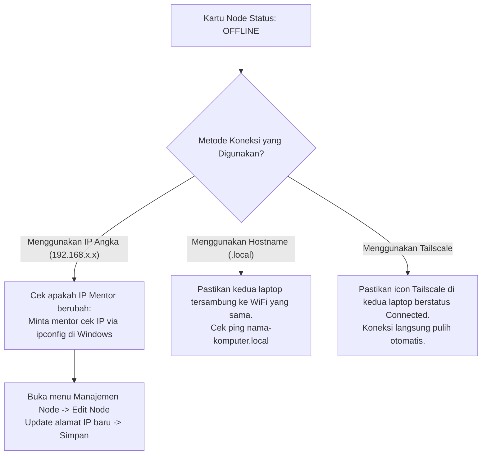

# 🌾 Panduan Operasional AgroSync Hub: Setup Node, Migrasi DDL, & Sinkronisasi

Panduan ini disusun secara langkah demi langkah (*step-by-step*) dengan bahasa yang mudah dipahami oleh pengguna umum (*non-technical friendly*). Dokumen ini mencakup panduan pembuatan database node baru, eksekusi migrasi skema DDL, sinkronisasi data DML, serta solusi penanganan perubahan IP (Hostname & Tailscale).

---

## 📑 Daftar Isi
1. [Langkah 1: Menambah Database Node Baru](#langkah-1-menambah-database-node-baru)
2. [Langkah 2: Menjalankan Migrasi Skema DDL](#langkah-2-menjalankan-migrasi-skema-ddl)
3. [Langkah 3: Menjalankan Siklus Sinkronisasi Data (DML)](#langkah-3-menjalankan-siklus-sinkronisasi-data-dml)
4. [Langkah 4: Rangkuman Solusi Mengatasi Perubahan IP Jaringan](#langkah-4-rangkuman-solusi-mengatasi-perubahan-ip-jaringan)
   - [Opsi 1: Menggunakan Hostname / Nama Komputer (Paling Mudah, Tanpa Alat Tambahan)](#opsi-1-menggunakan-hostname--nama-komputer-paling-mudah-tanpa-alat-tambahan)
   - [Opsi 3: Menggunakan Mesh VPN / Tailscale (Standar Enterprise & WFH)](#opsi-3-menggunakan-mesh-vpn--tailscale-standar-enterprise--wfh)
5. [Troubleshooting: Apa yang Harus Dilakukan Jika Koneksi Tiba-Tiba Offline?](#troubleshooting-apa-yang-harus-dilakukan-jika-koneksi-tiba-tiba-offline)

---

## Langkah 1: Menambah Database Node Baru

Setiap database perusahaan (seperti `API`, `AGC`, `TTM`) yang ingin disinkronkan dari Server Pusat ke Server Lokal didaftarkan sebagai **Database Node**.

### A. Persiapan Data yang Dibutuhkan
Sebelum membuka form, siapkan informasi berikut:
1. **Nama Entitas / Perusahaan:** Contoh: `AGC`, `API`, atau `TTM`.
2. **Server Pusat (Source):** Alamat IP / Hostname dan port server sumber. Contoh: `192.168.2.126,1433` atau `LAPTOP-MENTOR,1433`.
3. **Database Pusat:** Nama database di server pusat. Contoh: `AGCdb001`.
4. **User & Password Pusat:** Login SQL Server pusat. Contoh: User `sync_mentor` & Password `Sync@Mentor2026!`.
5. **Server Lokal (Target):** Alamat IP / Hostname dan port laptop lokal. Contoh: `192.168.2.99,1435` atau `localhost,1434`.
6. **Database Lokal:** Nama database lokal target. Contoh: `AGCdb001`.
7. **User & Password Lokal:** Login SQL Server lokal. Contoh: User `sa` & Password `PasswordSQLServer`.

---

### B. Langkah Menambahkan Node di Web Dashboard
1. Buka browser dan akses dashboard AgroSync Hub di: `http://localhost:5173`.
2. Pada menu sidebar sebelah kiri, klik menu **Manajemen Node** (ikon server).
3. Klik tombol hijau **"+ Tambah Database Node"** di pojok kanan atas.
4. Jendela dialog / modal input akan terbuka.
5. Isi data pada bagian **Identitas Perusahaan**:
   - Masukkan **Nama Perusahaan** (misal: `AGC`).
6. Isi data pada kolom kiri **Server Pusat (Source / HQ)**:
   - Host & Port: `192.168.2.126,1433` (atau gunakan Hostname).
   - Nama Database: `AGCdb001`.
   - Username & Password SQL Server Pusat.
   - Klik tombol **"Tes Koneksi Pusat"**. Pastikan muncul centang hijau: *Koneksi berhasil*.
7. Isi data pada kolom kanan **Server Lokal (Target / Branch)**:
   - Host & Port: `192.168.2.99,1435` (atau `localhost,1434`).
   - Nama Database: `AGCdb001`.
   - Username & Password SQL Server Lokal.
   - Klik tombol **"Tes Koneksi Lokal"**.
   - *Catatan Penting:* Jika muncul notifikasi bahwa database lokal belum ada, klik tombol **"Buat Database Otomatis"** yang muncul di modal. Sistem akan langsung membuatkan database kosong di SQL Server lokal agan!
8. Setelah kedua koneksi teruji aman, klik tombol **"Simpan Konfigurasi Node"**.
9. Node baru akan langsung tersimpan di file konfigurasi dan siap disinkronkan.

---

## Langkah 2: Menjalankan Migrasi Skema DDL

Sebelum data transaksi dapat ditransfer, database target lokal harus memiliki struktur tabel dan kolom yang identik dengan template ERP (330+ tabel).

1. Di menu sidebar sebelah kiri, klik menu **Migrasi Skema DDL** (ikon database bersusun).
2. Di halaman ini, agan akan melihat ringkasan audit skema (contoh: 330 tabel, 4.000+ kolom terverifikasi).
3. Klik tombol biru **"Jalankan Migrasi DDL Semua Node"** di pojok kanan atas.
4. Sistem akan secara otomatis:
   - Memeriksa setiap tabel di SQL Server lokal.
   - Jika tabel belum ada, sistem akan membuat tabel baru (`CREATE TABLE`) lengkap dengan Primary Key dan tipe datanya.
   - Jika tabel sudah ada tapi ada kolom yang kurang, sistem akan menambahkan kolom (`ALTER TABLE ADD COLUMN NULL`) tanpa menghapus data yang sudah ada (*Zero Data Loss*).
5. Tunggu beberapa detik hingga muncul notifikasi sukses:
   `✅ Migrasi DDL selesai: X tabel baru dibuat, Y kolom baru ditambahkan.`

---

## Langkah 3: Menjalankan Siklus Sinkronisasi Data (DML)

Setelah struktur tabel di lokal siap, sekarang saatnya menjalankan sinkronisasi data transaksi (INSERT, UPDATE, DELETE).

### A. Melalui Halaman Overview / Dashboard Utama
1. Klik menu **Overview** (ikon dashboard) di sidebar kiri.
2. Di bagian atas banner sistem, terdapat kontrol status mesin (*Engine Control*):
   - **Tombol "Mulai Sinkronisasi" (Hijau):** Menjalankan mesin di latar belakang (*background loop*). Mesin akan memeriksa dan menyinkronkan data secara otomatis setiap 10 detik.
   - **Tombol "Sinkronisasi Sekarang" (Biru):** Menjalankan 1 kali siklus sinkronisasi secara instan saat itu juga tanpa menunggu interval timer.
   - **Tombol "Jeda" (Kuning):** Menghentikan sementara proses sync tanpa mematikan aplikasi.
   - **Tombol "Stop" (Merah):** Menghentikan mesin kembali ke status IDLE / STOPPED.

### B. Memantau Hasil Sinkronisasi Secara Real-Time
1. **Kartu Transaksi Node:** Perhatikan bagian *"Aktivitas Transaksi Per Database Node"*. Angka **INSERT**, **UPDATE**, dan **DELETE** akan bertambah secara realtime seiring data masuk per tabel.
2. **Live Logs:** Klik menu **Live Activity Logs** di sidebar untuk melihat proses baris-demi-baris:
   - Contoh log: `📊 Tabel [Salesmen] tersinkronisasi: +4 Ins | ~0 Upd | -0 Del`
   - Fitur **Self-Healing DDL**: Jika ada kolom baru yang terdeteksi di pusat, sistem akan mencatat log:
     `🛠️ Self-Healing DDL: Menambahkan kolom [Table].[KolomBaru] ke target.`

---

## Langkah 4: Rangkuman Solusi Mengatasi Perubahan IP Jaringan

Ketika laptop berpindah lokasi atau terhubung ulang ke WiFi kantor/rumah, router WiFi secara otomatis memberikan nomor IP baru melalui mekanisme **DHCP**. Agar sistem tidak perlu bolak-balik ubah IP manual, gunakan salah satu dari 2 solusi terbaik berikut:

---

### Opsi 1: Menggunakan Hostname / Nama Komputer (Paling Mudah, Tanpa Alat Tambahan)

SQL Server tidak mewajibkan penulisan IP berupa angka. Kita bisa langsung menggunakan **Nama Komputer (Hostname)** perangkat.

#### Mengapa Opsi Ini Sangat Praktis?
Di dalam jaringan WiFi yang sama, sistem operasi (Windows & macOS) saling mengenali nama komputer melalui protokol **mDNS (Multicast DNS / Zeroconf)** dan **NetBIOS**. Besok lusa IP laptop mentor berubah dari `192.168.2.126` menjadi `192.168.2.150`, **nama komputernya tetap sama** dan sistem akan otomatis mencari IP barunya sendiri tanpa agan perlu mengganti konfigurasi!

#### 1. Cara Mengetahui Hostname Laptop Mentor (Windows)
Minta mentor membuka **Command Prompt (CMD)** atau **PowerShell**, lalu ketik:
```powershell
hostname
```
*Contoh hasil:* `LAPTOP-MENTOR` atau `DESKTOP-8K3N9P1`.

#### 2. Cara Mengetahui Hostname Laptop Agan (macOS)
Buka aplikasi **Terminal** di Mac, lalu ketik:
```bash
hostname
```
*Contoh hasil:* `rafioosadanis-MacBook-Air.local`.

#### 3. Cara Memasukkan ke AgroSync Hub
Di menu **Manajemen Node** (edit node):
- Kolom **Server Pusat**: Ganti `192.168.2.126,1433` menjadi:
  `LAPTOP-MENTOR,1433` atau `LAPTOP-MENTOR.local,1433`
- Kolom **Server Lokal**: Ganti `192.168.2.99,1435` menjadi:
  `rafioosadanis-MacBook-Air.local,1435` (atau cukup `localhost,1435` jika engine berjalan di laptop yang sama).
- Klik **Simpan**. Selesai!

> [!IMPORTANT]
> **Catatan Penting Opsi 1:** Penggunaan Hostname lokal (`.local`) **tetap mewajibkan kedua laptop berada dalam satu jaringan WiFi / LAN yang sama**.

---

### Opsi 3: Menggunakan Mesh VPN / Tailscale (Standar Enterprise & WFH)

Jika agan dan mentor bekerja di ruangan berbeda, beda jaringan WiFi, atau mentor bekerja dari rumah (**WFH / Remote**), maka Opsi 1 tidak bisa tembus. Solusi standar industri modern yang paling aman dan mudah adalah **[Tailscale](https://tailscale.com/)** (gratis).

#### Apa Itu Tailscale?
Tailscale menghubungkan laptop agan dan laptop mentor ke dalam satu "jaringan kabel virtual pribadi" yang terenkripsi aman (*WireGuard Mesh VPN*). Setiap laptop akan diberi **IP Virtual Statis Permanen** yang tidak akan pernah berubah seumur hidup.

#### 1. Langkah Pemasangan (Hanya 3 Menit)
1. Buka [https://tailscale.com](https://tailscale.com) di laptop agan dan laptop mentor.
2. Download dan install aplikasinya (tersedia untuk Windows dan Mac).
3. Login menggunakan akun Google atau GitHub yang sama (atau gunakan fitur *Tailscale Share Node / Invite*).
4. Klik icon Tailscale di taskbar/menu bar untuk menyalakan koneksi (*Connected*).

#### 2. Cara Melihat IP Tailscale
- Di aplikasi Tailscale masing-masing laptop, akan muncul IP berawalan `100.x.y.z`.
- Contoh:
  - Laptop Mentor: `100.85.20.110` (nama: `mentor-pc`)
  - Laptop Agan: `100.85.20.125` (nama: `rafi-macbook`)

#### 3. Cara Memasukkan ke AgroSync Hub
Di menu **Manajemen Node**:
- **Server Pusat**: Masukkan IP Tailscale mentor: `100.85.20.110,1433`
- **Server Lokal**: Masukkan IP Tailscale lokal: `100.85.20.125,1435` (atau `localhost,1435`)

#### Keunggulan Luar Biasa Opsi 3:
- **Beda Jaringan Tetap Konek:** Laptop mentor di rumah pakai WiFi Indihome, agan di kantor pakai WiFi kantor, atau tethering HP -> **Sinkronisasi tetap berjalan lancar!**
- **IP Permanen:** Mau restart laptop 100 kali, IP `100.85.20.110` tidak akan pernah berubah.
- **Keamanan Tingkat Tinggi:** Koneksi dienkripsi penuh, aman dari penyadapan di WiFi publik.

---

## Troubleshooting: Apa yang Harus Dilakukan Jika Koneksi Tiba-Tiba Offline?

Jika besok pagi kartu status node berwarna merah (**OFFLINE**):



1. **Jika Menggunakan IP Angka Biasa:**
   - Kemungkinan besar router kantor telah mengganti IP laptop mentor.
   - Minta mentor membuka CMD dan ketik `ipconfig` untuk melihat IP barunya.
   - Buka menu **Manajemen Node** di AgroSync Hub, klik tombol **Edit** (ikon pensil), ganti nomor IP dengan yang baru, lalu klik **Simpan**.
2. **Jika Menggunakan Hostname (Opsi 1):**
   - Pastikan laptop agan dan laptop mentor sama-sama terhubung ke SSID WiFi yang sama (bukan yang satu di WiFi Tamu dan satu di WiFi Kantor).
3. **Jika Menggunakan Tailscale (Opsi 3):**
   - Pastikan aplikasi Tailscale di laptop mentor dan laptop agan sama-sama dalam kondisi menyala (*Connected*).
